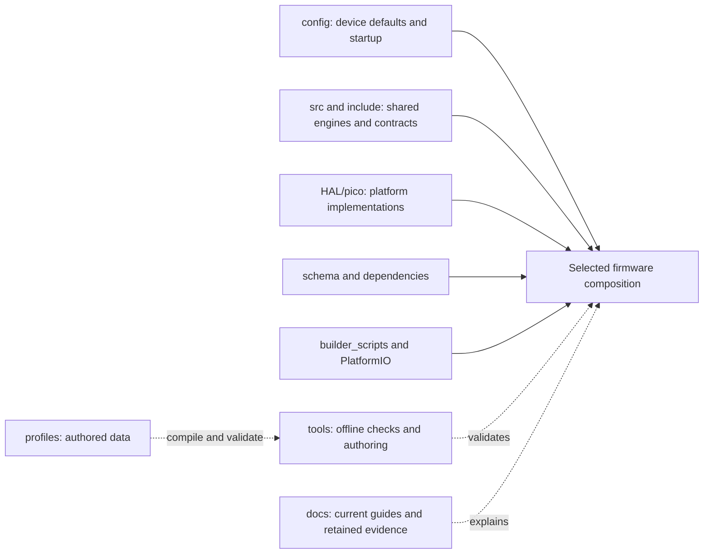
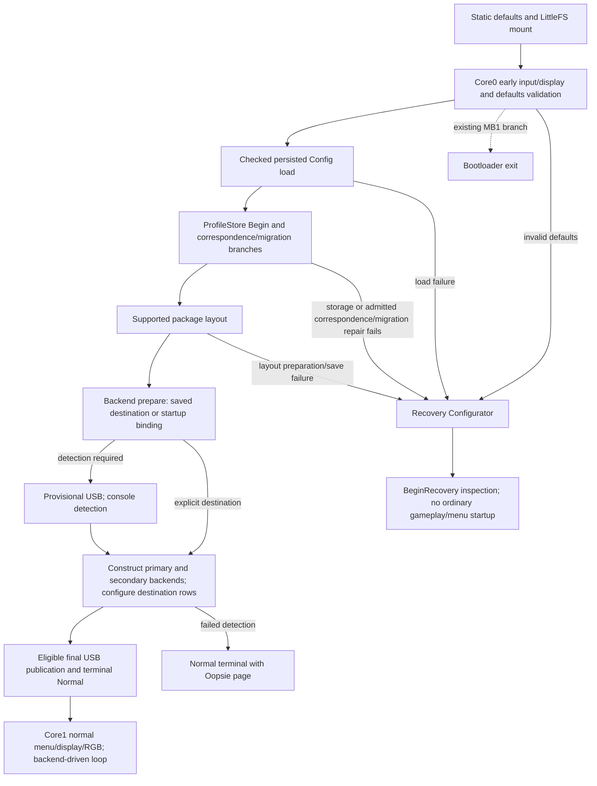
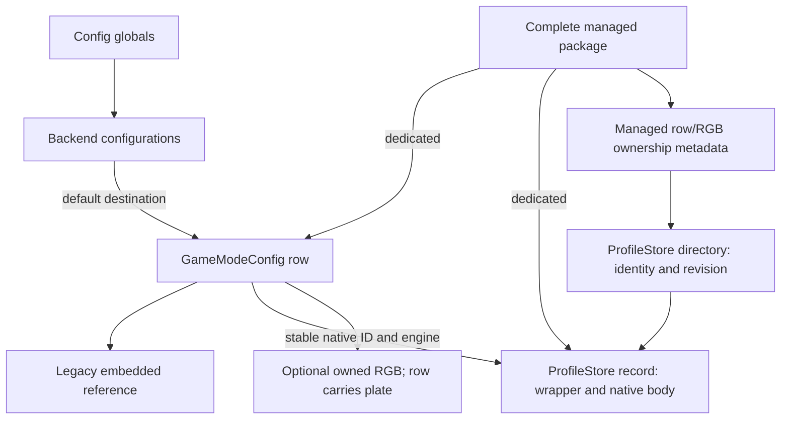
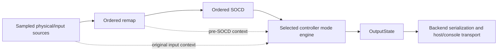
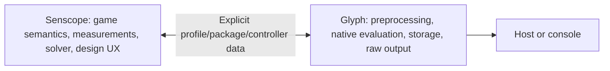

# Architecture

## Scope

This is the current Glyph firmware/backend/storage architecture, built on HayBox.
The Senscope browser application is a separate product. Native Ultimate is one
mode path, not the architecture of all modes. Source existence, product exposure
and hardware qualification remain separate; [capabilities](CAPABILITIES.md) owns
that inventory and [current state](CURRENT_STATE.md) owns scoped qualification.
[Development](DEVELOPMENT.md) explains builds and change evidence.

## Repository map

| Directory | Current responsibility |
| --- | --- |
| `src/` | Shared core, mode engines, native evaluator, backend helpers, input/display logic |
| `include/` | Shared interfaces, state, mode/storage/package contracts and prototype flags |
| `HAL/` | Platform implementations: Pico persistence, USB/console backends, input, display and hardware glue; AVR alternatives also exist |
| `config/` | Environment inheritance, device defaults/overrides, startup/loops, pin/matrix/LED/display configuration |
| `schema/` | Protobuf definitions and Nanopb bounds/options; generated code is a build input |
| `profiles/` | Human native-profile sources, schemas, seeds/examples and scoped profile references |
| `tools/` | Offline authoring, host fixtures, validation, identity/correspondence and management tooling; not all tools are device-safe entry points |
| `builder_scripts/` | PlatformIO prebuild identity, generated headers and native target metrics hooks |
| `scripts/` | Build wrappers and bounded logging helpers |
| `.github/workflows/` | Hosted current-host, validation and classified firmware build jobs |
| `docs/` | Current public guides plus retained design, campaign, history and evidence inputs |

Production/build inputs extend beyond `src/**`. HAL implementations, config
headers/defaults, schemas/options, libraries, builder scripts and resolved external
packages affect the artifact. PlatformIO sets `src_dir = ./` and selects multiple
source roots; the tree is not compiled by simply taking every file under `src/`.



The separate canonical public documentation map is: [README](../README.md) for
players/routes; [docs index](README.md) for navigation/glossary;
[CURRENT_STATE](CURRENT_STATE.md) for present status;
[CAPABILITIES](CAPABILITIES.md) for exposure/qualification;
[USAGE](USAGE.md) for current workflows; [PROFILE_SYSTEM](PROFILE_SYSTEM.md) for
native semantics; ARCHITECTURE for system relationships;
[DEVELOPMENT](DEVELOPMENT.md) for contribution/build/test rules;
[ROADMAP](ROADMAP.md) for future intent; and
[profiles/README](../profiles/README.md) for exact authoring.

## Build architecture

[platformio.ini](../platformio.ini) and [config/glyph/env.ini](../config/glyph/env.ini)
compose `glyph_mk6` through `glyph_base` and `arduino_pico_base`: Pico board,
Arduino-Pico core 3.6.3 on a pinned Raspberry Pi platform revision, 130 MHz,
0.5 MB filesystem, `-O3`, TinyUSB, HAL/config include roots and Glyph device inputs.
Mk6 enables `GLYPH_PACKAGE_V1=1` and
`GLYPH_MK6_FINAL_USB_GAMEPAD_REENUMERATION=1`, stack-usage files and a linker map.
The native evaluator is compiled shared mode source; there is no single switch
that turns all mode engines into native Ultimate.

Nanopb processes `schema/haybox/config.proto`, its
[options](../schema/haybox/config.options) and the Mk6
[package schema](../schema/haybox/package.proto). Dependencies include the
Glyph-selected HayBox-proto revision, Nanopb, TinyUSB XInput, FastLED, NES PIO,
Nunchuk, GFX/SSD1306, PacketIO, CRC32, PCF8575 and TUCompositeHID. Declared pins,
resolved packages and generated output are different provenance facts.

[arduino_pico.py](../builder_scripts/arduino_pico.py) derives firmware Git identity.
[native_target_metrics.py](../builder_scripts/native_target_metrics.py) requires
clean committed Mk6 source, generates the complete source-SHA byte header in
build output, enables native diagnostics and installs linker wrappers for `main`
and core1 launch. It does not grant hardware acceptance. The
[CI classifier](../tools/glyph_ci_build_inputs.py) and
[tracked integrity checker](../tools/glyph_tracked_worktree_integrity.py) protect
broader input/identity boundaries; see [development](DEVELOPMENT.md).

```text
source tree + declared/resolved dependencies
  -> PlatformIO + builder scripts + protobuf generation
  -> ELF/map/stack outputs and firmware UF2 (build proof)

exact tested source -> exact retained tested UF2 + SHA-256
  -> recorded physical test scope (hardware acceptance)
```

A later CI build is not the accepted artifact merely because source behavior is
unchanged. Hosted postprocessing/provenance is described by
[the workflow](../.github/workflows/build.yml); its observed-only sidecar does not
establish understood transformation, reproducibility or physical acceptance.

## Startup / initialization

The Mk6 entry points are `setup`, `loop`, `setup1` and `loop1` in
[config/glyph/common/src/config.cpp](../config/glyph/common/src/config.cpp), with
[Glyph overrides](../config/glyph/common/include/glyph_overrides.hpp).
[Persistence](../HAL/pico/src/core/Persistence.cpp) mounts LittleFS during global
construction with automatic formatting disabled. Defaults and global mode/input
objects also exist before setup.

Core0 setup attempts early display/input initialization and retains its existing
MB1 bootloader branch. Ordinary startup validates source defaults, then requires
checked persisted Config loading. A failed load does not silently authorize normal
execution from defaults. ProfileStore begins with the expected incarnation/root
format; compact correspondence/migration receipts are checked, pending migration
is completed only where admitted, and legacy embedded import is a separate
legacy/nonempty branch. Supported package layout is established before backends.

Only then does boot initialize/detect backends, apply each selected default row
through mode configuration, and publish terminal Normal boot. Core1 waits for a
terminal publication before normal menus/display/RGB initialization. Production
Mk6 finalizes USB with disconnect/reconnect only for successfully selected final
XInput, DInput or Switch execution. Configurator and legacy console transports
are excluded from that final USB publication.



This diagram preserves two different failures. Storage/Config/migration failures
enter inspection-only [recovery initialization](../include/core/RecoveryInitialization.hpp)
using `BeginRecovery`, constructing Configurator and publishing recovery facts.
Backend detection failure instead retains a backend, marks `failed_detection`,
and reaches the normal-terminal Oopsie UI. It is not the same storage recovery.

[backend_init.cpp](../HAL/pico/src/comms/backend_init.cpp) splits preparation from
finish: validate indices/callbacks; consume a valid committed one-shot destination
or startup/watchdog selection; construct provisional USB when detection needs
it; detect and construct the final primary; save applicable legacy watchdog
selection; construct secondary output and configure default modes. A checked
already-committed destination is not saved again.
[Console detection](../HAL/pico/src/comms/console_detection.cpp) distinguishes
bounded USB/legacy-console cases; USB detection uses the configured USB destination,
not an omniscient detector of every host protocol.

## Configuration ownership

[Config](../schema/haybox/config.proto) supplies globals and bounded rows;
[ProfileStore.hpp](../include/core/ProfileStore.hpp) supplies directory/record
contracts. [PROFILE_SYSTEM](PROFILE_SYSTEM.md#ownership-matrix) owns the detailed
field ownership and native semantics.

| Layer | System relationship |
| --- | --- |
| Config globals | Backend configurations/default destinations, startup bindings, RGB collection/brightness and global options |
| Communication backend configuration | Chooses transport and a one-based default GameModeConfig destination |
| GameModeConfig row | Mode engine, name/plate/icons, remaps/SOCD, backend eligibility, activation/RGB and optional/native references |
| Embedded or native references | Legacy one-based embedded selector and stable native store ID are distinct paths |
| ProfileStore directory / record | Directory identifies stable ID, revision, schema, rank/name and allocation state; record carries the UltimateProfile wrapper |
| Managed ownership metadata | Records dedicated row and optional RGB ownership and managed format |
| Complete managed package | One logical profile owns the paired dedicated Ultimate row + native record + optional RGB; plate belongs to the row |



A Config row is not a ProfileStore record; neither alone is a complete package.
The 30-row shared Config budget and 64-entry store directory are independent;
neither guarantees capacity for that many complete packages. Human authoring JSON
compiles native data, not a complete package or saved Config.

## ProfileStore and package lifecycle

[ProfileStore.cpp](../HAL/pico/src/core/ProfileStore.cpp) manages persistent
native directory/records and owned active-view lifetime.
[PackageOwnership](../include/core/PackageOwnership.hpp) validates backing-object
relationships. Managed record/directory fields are explicitly serialized, not
raw persisted C++ structs. Ordinary Config/store writers cannot independently
mutate managed backing objects as though they were unowned.

Package handling separates observation from admitted mutation:

1. [PackageRequestWire](../include/core/PackageRequestWire.hpp) strictly decodes
   the envelope/request and body; decoding success grants no write authority.
2. [GlyphPackageSourceReader](../include/core/GlyphPackageSourceReader.hpp) supplies
   synchronous read-only facts from the same mounted filesystem, binding Config,
   row/RGB and native data to exact paths/indices and semantic/context checks.
3. [Namespace classification](../include/core/PackageNamespaceClassifier.hpp),
   implemented in [PackageNamespaceClassifier.cpp](../src/core/PackageNamespaceClassifier.cpp),
   checks roots/control/intent, records, ownership, receipts and Config correspondence.
   It returns logical disposition/storage floor with default-deny write fencing.
   Checked-I/O uncertainty remains unresolved/fenced; the classifier obtains no writer.
4. [CREATE preparation/publication](../HAL/pico/src/core/ProfileStorePackage.inc)
   and [lifecycle preparation/publication](../HAL/pico/src/core/ProfileStoreLifecycle.inc)
   additionally require exact Config hash/generation, store incarnation/generation,
   request/receipt identity, source/native context, capacity and baseline rereads
   before acquiring a scoped writer. Publication is staged and final state reobserved.

| Operation | Architectural role, not an operator recipe |
| --- | --- |
| CREATE | Materializes the dedicated row, schema-5 native record, ownership markers and optional RGB as a logical package |
| STATUS / QUERY | Observe/classify storage and durable transaction outcome; do not publish mutations |
| UPDATE | Replaces dedicated row/body and adjusts dedicated RGB, preserving stable ID |
| RENAME | Synchronizes record and row names |
| REORDER | Changes display rank |
| DELETE | Removes owned objects and compacts affected indices, with destination/reference/share protections |

All lifecycle operations refuse the currently executing record ID. DELETE also
protects backend destinations, reference receipts and shared references. Matching
durable receipts allow retries to report prior outcomes without publishing again;
this is separate from granting a new request permission. A failed operation cannot
casually clear a sticky fence or be assumed to have rolled back successfully.

[PackageStorageFormat](../include/core/PackageStorageFormat.hpp) and its
[implementation](../src/core/PackageStorageFormat.cpp) define stored control/intent/
receipt encodings. Package schema, protocol, native and storage versions are
separate domains already documented in
[PROFILE_SYSTEM version contracts](PROFILE_SYSTEM.md#version-contracts).

## Selection / activation architecture

These stages answer different questions:

| Stage | What it selects or proves |
| --- | --- |
| Communication-backend destination | Configured USB/console/backend configuration chosen by startup/detection or admitted persisted destination |
| Row/mode destination | Backend's one-based GameModeConfig row; its mode ID dispatches an engine |
| Ordinary profile selection | Enumerates eligible destinations and requests a checked persisted choice; not arbitrary record activation |
| Native ProfileStore activation | `Activate(id)` obtains an owned native view used by Ultimate with schema/engine/preprocessing context checks |
| Managed ownership/eligibility | Exactly one bound row plus native ID/schema/engine, backend eligibility and reciprocal row/RGB markers |
| Boot-bound execution | Save destination, reboot, then configure the executing engine from validated state |

[profile_selection.cpp](../src/core/profile_selection.cpp) lists eligible ordinary
nonmanaged rows (excluding compact Ultimate rows), then rank-sorted native entries with exactly one bound row. Orphan raw store
records remain management data, not ordinary selectable profiles.
[ProfileSelection.hpp](../include/core/ProfileSelection.hpp) reloads checked Config,
refuses fences/recovery/migration/incarnation conflicts, verifies the unique row
and native context, then saves backend/default-row destinations with a generation
guard. Package selection does not rewrite the row's native ID. Core1 requests
selection through a mailbox; core0 validates/persists and reboots, with additional
GameCube idle admission. Non-native ordinary menu choices retain their watchdog/
reboot route; Keyboard forces DInput. Configurator excludes ordinary enumeration.
See [DefaultConfigMenu](../HAL/pico/src/display/DefaultConfigMenu.cpp).

Source-backed selection machinery is not a claim of completed ordinary managed
selection product acceptance. Current workflow/qualification limits remain in
[USAGE](USAGE.md) and [CAPABILITIES](CAPABILITIES.md). There is no general live
hot-swap guarantee. Stored names are not proof of execution:
[CurrentProfileLabel](../HAL/pico/src/display/CurrentProfileLabel.cpp) requires
Ultimate/native engine, selected record, active ID, owned native-view lease,
a nonzero active revision and validated native generation before using directory metadata as an
executing label; otherwise it falls back to the row name. Dashboard and OLED
Input Viewer call that helper. Accepted dashboard observation does not establish
physical Input Viewer naming, managed activation/display or known-plate cases;
those retain their documented gaps.

## Mode architecture

[mode_selection.cpp](../src/core/mode_selection.cpp) dispatches nine concrete
normal engines: Melee, Project M, Ultimate, FGC, Rivals of Aether, Rivals 2,
Keyboard, Custom and Smash64. A stock row label is not a mode engine; a mode
engine is not a communication backend. For example stock Brawl uses Project M,
GameCube/N64 labels use Melee, and SNES/NES labels use FGC. See
[stock rows](../config/glyph/common/include/glyph_overrides.hpp)
and [capabilities](CAPABILITIES.md) for exposure; support is not every possible
engine/backend cross-product.

Keyboard requires DInput execution and a valid keyboard-config reference, with
its own keyboard report path. `MODE_CUSTOM` uses
[CustomControllerMode](../src/modes/CustomControllerMode.cpp) and `Config.custom_modes`,
separately from native Ultimate.

Compact Ultimate activates the store ID; legacy embedded selection is separate.
[Ultimate](../src/modes/Ultimate.cpp) admits native execution only with the required
engine/schema, published owned view and matching preprocessing context. A required
native program that is unavailable produces neutral output, not an automatic
successful legacy fallback. Native evaluator internals belong in
[PROFILE_SYSTEM](PROFILE_SYSTEM.md#exact-native-evaluation-flow).

The Senscope prototype object is compiled in the dispatcher but lies outside
ordinary Config/schema/stock-mode wiring. Its manual debug selection defaults OFF
in [build flags](../include/prototypes/senscope/SenscopePrototypeBuildFlags.hpp).
The separate `glyph_mk6_senscope_playtest` environment enables it; production Mk6
does not expose that manual chord. This does not imply Senscope integration acceptance.

## Input-to-output runtime pipeline

For controller modes, [ControllerMode](../src/core/ControllerMode.cpp) and
[InputMode](../src/core/InputMode.cpp) implement:



The original state is retained; remaps use the original inputs, first physical
source entry wins, and multiple sources can OR into one destination. Remaps do
not chain or provide arbitrary duplicate fanout. SOCD pairs run in order. Native
Ultimate receives original/pre-SOCD/post-SOCD contexts; its internal evaluator
pipeline is documented only in [PROFILE_SYSTEM](PROFILE_SYSTEM.md).

Backend `SendReport` controls sampling, readiness/timing and serialization;
[DInput](../HAL/pico/src/comms/DInputBackend.cpp) and
[XInput](../HAL/pico/src/comms/XInputBackend.cpp) have different waits/scans.
The core loop does not impose one universal scan schedule on every transport.
**Keyboard exception:** [KeyboardMode](../HAL/pico/src/core/KeyboardMode.cpp)
computes a remapped/SOCD copy but calls `UpdateKeys` with original inputs. This
retained characterized behavior must not be mistaken for the controller pipeline;
no transformed-keyboard fix or physical Keyboard qualification is implied.

DInput/XInput construction also adds a secondary
[B0XX Input Viewer](../src/comms/B0XXInputViewer.cpp) for sampled input bits over
serial. This secondary backend is distinct from the OLED Input Viewer.

## Backend architecture

The current Pico [constructor dispatcher](../HAL/pico/src/comms/backend_init.cpp)
implements these backends through [CommunicationBackend](../include/core/CommunicationBackend.hpp)
and the [ControllerMode](../include/core/ControllerMode.hpp)/
[InputMode](../include/core/InputMode.hpp) contracts:

| Backend | Current system role |
| --- | --- |
| XInput | USB gamepad output; secondary B0XX viewer constructed |
| DInput | USB gamepad plus keyboard descriptors/path; secondary B0XX viewer constructed |
| Nintendo Switch USB | Switch USB controller transport |
| GameCube | Console-wire controller transport |
| N64 | Console-wire controller transport |
| NES | Console-wire controller transport |
| SNES | Console-wire controller transport |
| Configurator | Firmware configuration/ProfileStore/package transport and bounded recovery reporting |

PS4/PS5 enum presence is not backend implementation: neither has a current
constructor case. Configurator firmware transport is distinct from the retired
official configurator website; the website is not a build/development dependency.
Source support here carries no additional physical qualification.

## Storage / recovery / safety boundaries

Persistent Config, native ProfileStore and managed package publication share
filesystem/correspondence constraints but own different objects. Config loading,
root/record selection, migration receipts, managed ownership and package transaction
state must agree. Read-only source classification precedes mutation admission.
Default-deny fences prevent unsupported/corrupt/uncertain states from becoming
casual write permission. Recovery-only startup exposes bounded inspection rather
than normal gameplay or automatic filesystem formatting. It is not a recovery
manual or authorization to erase, repair or flash a device.

Ordinary/root and managed formats retain separate readers and supported
compatibility contracts. API-visible readback preservation is not raw-flash equality,
and host fault tests are not physical power-loss qualification. Detailed admitted
operations require their own authority; this map adds none.

## Senscope boundary

The committed [Senscope handoff](planning/final-usb-gamepad/acceptance/SENSCOPE_HANDOFF.md)
and [profile-system ownership](PROFILE_SYSTEM.md#ownership-matrix) define the boundary.

| Senscope owns | Glyph firmware owns |
| --- | --- |
| Game semantics and measured raw-to-effective mappings | Controller preprocessing and raw virtual-controller output |
| Solver/query logic | Finite native program evaluation |
| Profile-design UX and future Builder workflow | Config/ProfileStore/package realization |
| App-side interpretation and intended requirements | Transport/backend output |



The boundary exchanges explicit data, not hidden game assumptions. Glyph table
names/character metadata do not establish Smash thresholds, facing or move
recognition. Senscope complete-path acceptance remains separate and incomplete;
firmware physical qualification does not complete Builder/install acceptance.

## Current architecture versus target documentation structure

The CURRENT REPOSITORY IMPLEMENTATION STRUCTURE is the source map above.
The TARGET PUBLIC DOCUMENTATION STRUCTURE is the following reader-facing map:

```text
README.md
AGENTS.md                         coding-agent instructions
docs/
  README.md
  CURRENT_STATE.md
  CAPABILITIES.md
  USAGE.md
  PROFILE_SYSTEM.md
  ARCHITECTURE.md
  DEVELOPMENT.md
  ROADMAP.md
  history/...                     target historical decisions/milestones
  evidence/...                    target evidence index
profiles/
  README.md
  schema/
  examples/
  templates/
```

This is a documentation target, not a proposal to move firmware source directories.
The history/evidence destinations describe later consolidation; old campaign and
governance documents remain intact. Documentation ownership/maintenance rules live
in [DEVELOPMENT](DEVELOPMENT.md#documentation-maintenance-policy).
