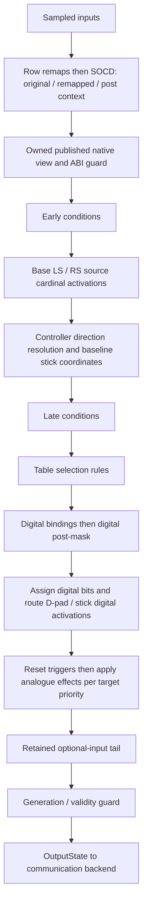

# Profile System

For repository/system relationships see [architecture](ARCHITECTURE.md);
for build, tests and contribution rules see [development](DEVELOPMENT.md).

## Scope and terminology

This describes the **current native Ultimate profile system**. Ultimate also has
legacy paths; other Glyph mode engines have their own logic. The dispatcher in
[mode_selection.cpp](../src/core/mode_selection.cpp) and native admission in
[Ultimate.cpp](../src/modes/Ultimate.cpp) determine which engine runs. A row that
requires native engine 1 but lacks a usable, context-matched native profile fails
to neutral output rather than silently adopting legacy behavior.

Use [profiles/README.md](../profiles/README.md) for the exact authoring contract,
schema, seed and offline commands. This document explains the system; it does
not replace that schema. [Capabilities](CAPABILITIES.md) separates implementation
from product workflow and physical qualification; [usage](USAGE.md) owns the
current user route.

Physical input is the sampled controller input state. A Config **GameModeConfig
row** chooses a mode and supplies preprocessing/remap/SOCD and row settings.
Native authoring source is human v1 JSON; its compiled **native body** is finite
evaluator data inside a schema-5 UltimateProfile protobuf wrapper. A
**ProfileStore record** adds identity, revision and storage metadata. A
**complete managed package** owns a dedicated row and record, with package
metadata and optional RGB. None of these is the communication backend, which
serializes/transports output. Game semantics (moves, thresholds, facing and
recognition) are separate authority; a character annotation does not provide them.

## Ownership matrix

The current contracts are [Config](../schema/haybox/config.proto),
[Config bounds](../schema/haybox/config.options),
[PackageBody/PackageMode](../schema/haybox/package.proto),
[ProfileStore](../include/core/ProfileStore.hpp),
[package publication](../HAL/pico/src/core/ProfileStorePackage.inc) and
[ownership validation](../include/core/PackageOwnership.hpp).

| Layer | Owns | Boundary |
| --- | --- | --- |
| Device / Config global | Backend configurations, their default row destinations and startup bindings; default USB backend/fallback destinations; RGB collection and overall brightness; dashboard default and some Melee/Project M options | A native table does not choose transport or global brightness. `secondary_backends` is currently unused. |
| Game mode / profile row | Mode engine, row name, layout plate, menu icons, ordered remaps, ordered SOCD pairs/policies, activation binding, applicable backends, RGB reference, native engine/reference fields | `ultimate_profile_config` is the historical one-based embedded index; `ultimate_profile_id` is a stable store ID. Native engine 1 requires schema 5. |
| Native source / body | Tables, conditions, direction sources, gates, D-pad routing flags, table rules, digital bindings, analogue effects, digital post-mask, preprocessing fingerprint and authored-source provenance | Source `name`/metadata annotate authoring; they do not rename a record or set package rank/plate/RGB. |
| ProfileStore | Stable record ID, revisions, payload version/body wrapper, name, display rank; directory generation/incarnation and identity allocation | Managed entries additionally track owned row/optional RGB slot and managed format. Storage admission is separate from native program admission. |
| Complete managed package | Package name/rank, dedicated Ultimate row + native body/record + optional dedicated RGB; plate is carried by the row | Package preparation fixes MODE_ULTIMATE/native engine 1 and binds the body fingerprint to that row. Backing objects cannot be shared arbitrarily. |
| Communication backend | Output serialization and transport to the selected destination | Backend support is not a game-move or physical-qualification guarantee. |
| Game semantics | User/domain requirements and separately authoritative game knowledge | No native character model, facing detector or solver is supplied here. |

The shared **30-row** Config budget and **64-entry** ProfileStore directory limit
are independent. They do not promise 64 selectable packages or sufficient storage
for every combination. The body fingerprints the ordered row preprocessing; the
JSON includes that contract but compilation does not create or change a row.

## Version contracts

These are independent version domains, not one “profile version”.

| Contract | Current value / meaning | Source |
| --- | --- | --- |
| Human authoring `formatVersion` | Integer 1 for current authored sources; 0 remains supported for archival byte-preserving representation | [codec](../tools/glyph_native_profile_json.py), `_profile_version` |
| Native body/evaluator | UltimateProfile schema **5**; magic **GNP5**; encoding **1**; engine ABI **1** | [native constants](../include/modes/UltimateNativeProfile.hpp) |
| Complete managed package body/schema | `PackageBody.version = 1`, advertised `package_schema_version = 1` | [wire admission](../include/core/PackageRequestWire.hpp), [package implementation](../HAL/pico/src/core/ProfileStorePackage.inc) |
| Package envelope protocol | **3** for CREATE; **3/4** for STATUS/QUERY; **4** for UPDATE/RENAME/REORDER/DELETE (operations 17–20) | [PackageRequestWire.hpp](../include/core/PackageRequestWire.hpp) |
| Package capability version | Protocol 3 advertises **1**; protocol 4 advertises **2** | [ProfileStorePackage.inc](../HAL/pico/src/core/ProfileStorePackage.inc) |
| Managed markers / Config store marker | Managed package format **1**; compact Config store format **1** | [ProfileStore.hpp](../include/core/ProfileStore.hpp), [Config](../schema/haybox/config.proto) |
| Root / record storage | Ordinary root **2**, record **1**; managed root **3**, record **2** | [ProfileStore.cpp](../HAL/pico/src/core/ProfileStore.cpp), [PackageStorageFormat.cpp](../src/core/PackageStorageFormat.cpp) |
| Managed receipt/intent | CREATE **1**; lifecycle **2** | [PackageStorageFormat.cpp](../src/core/PackageStorageFormat.cpp) |

“Lifecycle v2” is not PackageBody v2. The existing production record tool uses
ProfileStore protocol **2**; that is also distinct from the package envelope.
The historical v0 author's fixed table labels do not constrain v1 table names.

## Input/preprocessing domains

[ControllerMode::UpdateOutputs](../src/core/ControllerMode.cpp) copies the
original state, applies remaps, applies SOCD and supplies the native context.
[InputMode.cpp](../src/core/InputMode.cpp) defines preprocessing: remaps inspect
the original inputs, the first entry for each physical input wins, remapped
sources are not chained, and multiple physical inputs may OR into one destination.
Unremapped inputs pass through. SOCD pairs then run in declared order with their
selected policies, including stateful second-input policies. Array order matters.

| Token | Observes |
| --- | --- |
| `original:ID` | Original sampled button state before row remaps/SOCD |
| `preSocd:ID` | Remapped button state before SOCD |
| `postSocd:ID` | State after row remaps and SOCD |
| `condition:name` | An already evaluated named condition |
| `direction:name` | One of eight base LS/RS source cardinal activations |
| `finalDigital:name` | The 12-bit binding result after digital post-mask, before D-pad/stick digital routing; not all of OutputState |
| `true`, `false` | Constant tokens (JSON strings) |

The available input IDs and direction/output symbols are enumerated by the
[v1 schema](../profiles/schema/glyph-native-ultimate-profile.v1.schema.json).
Logic does not universally observe post-SOCD inputs: each token chooses a domain.
The stage restrictions below come from [native Prepare/Token admission](../src/modes/UltimateNativeProfile.cpp)
and the matching [offline validator](../tools/convert_glyph_native_ultimate_profile.py).

| Consumer | Input domains / constants | `condition:` | `direction:` | `finalDigital:` |
| --- | --- | --- | --- | --- |
| Early condition | Yes | Earlier only | No | No |
| Late condition | Yes | Earlier only | Yes | No |
| Base left/right direction source | Yes | Early only | No | No |
| Other effect direction source | Yes | Any defined | Yes | No |
| Table rule, digital binding, post-mask gate, four header gates | Yes | Any defined | Yes | No |
| Analogue activation / gate | Yes | Any defined | Yes | Yes |

The four header gates are Mode, left/right stick digital and D-pad. Even though
all token strings share schema syntax, a consumer can reject a token's domain.
A direction source used as a base source has the stricter base restrictions even
if an analogue effect also references it.

## Direction sources and nine-way indexing

A named source explicitly supplies `left`, `right`, `down`, `up` tokens. For
stick coordinate indexing, [Axes in the evaluator](../src/modes/UltimateNativeEvaluator.cpp)
reduces these booleans as follows:

```text
x = left ? -1 : right ? 1 : 0
y = down ? -1 : up ? 1 : 0
human key = (y + 1) * 3 + x + 2

7 8 9
4 5 6
1 2 3
```

If both horizontal tokens are true, left wins for indexing; if both vertical
tokens are true, down wins. This reduction follows the configured source and
its domain semantics, not an assumed physical layout or a new SOCD policy.

**Key 5 is ordinary stored data and may be non-center.** It selects the fifth
point when that effect's source has no resulting horizontal/vertical direction.
A RIGHT source state selects key 6, whose stored coordinate may intentionally be
DOWN-LEFT. The table index need not match a physical button direction or the
output coordinate's geometry. There is no automatic character-facing awareness.

`direction:` tokens and digital routing retain the base source booleans, not the
reduced x/y or the analogue result. Opposing source activations can therefore both
be visible if the chosen source bypasses their SOCD reduction. Nonbase sources
are evaluated when an effect needs them and may use late conditions/directions.

## Exact native evaluation flow

The order below follows [UltimateNativeEvaluator.cpp](../src/modes/UltimateNativeEvaluator.cpp)
and [ControllerMode.cpp](../src/core/ControllerMode.cpp). It applies only to the
native Ultimate path.



The frame starts with the default table and zero binding bits. Controller
`UpdateDirections` establishes baseline stick coordinates using raw 28/128/228
before late conditions; selecting a table later does not itself replace those
coordinates. Native-owned digital fields are assigned each frame while the
explicit unowned mask `0xf0030000` is retained.

After effects, the retained Nunchuk C tail ORs RS source activations into D-pad
and centers RS; connected Nunchuk input replaces LS with its post-context raw
bytes. This is a source statement only; **Nunchuk remains NOT_TESTED**.
The initial ownership/publication/ABI guard and final generation/validity guard
neutralize output on failure. Preprocessing fingerprint/admission happens before
frame evaluation, not through package installation inside this diagram.

## Conditions and stages

Each named condition has finite `all`, `any`, `none` arrays: every `all` token
must be true; nonempty `any` requires at least one true token; every `none` token
must be false. Empty `any` imposes no constraint. Empty clauses are legal.

Early conditions form a prefix of the array. References must point to earlier
conditions, so self/forward/cyclic condition dependencies fail. Base sources can
reuse early conditions; late conditions run after base cardinal resolution and
can observe `direction:`. They observe cardinal activations as described above,
not a game direction inferred from raw output. Names let several rules/bindings
share one condition; this is finite composition, not arbitrary Boolean scripting.

## Table selection

The frame starts at `defaultTable`. Active `tableRules` compete by priority;
the lowest numeric value wins. Priorities are unique 1..255; the evaluator's
initial sentinel is 256, so 255 can win. Activation is one admitted token, which
may reuse a named compound condition. Rule order does not break priority ties:
collisions are rejected.

V1 names resolve to explicitly declared sparse slots 0..27. All 28 wire slots
still contain nine points; undeclared slots are neutral-filled with `[128,128]`
and cannot be referenced by v1 names. A declared neutral table remains selectable.
No current firmware default coordinates are inherited.

Keep three concepts distinct: **selected-table state** records the winning rule;
an effect with `coordinates.mode = selectedTable` consumes that state; an effect
with mode `table` instead chooses its own normal/Mode table. Winner filters may
constrain either effect independently. A selected table does not magically
replace every output path, or even baseline LS without an eligible consumer.

## Digital behavior

Every active `digitalBinding` whose `winnerTable` matches (or is `any`) ORs its
named output bits into the frame accumulator. Several independent bindings can
contribute the same bit; there is no single exclusive binding winner. Binding
filters compare the selected table, not an effect's explicitly chosen table.

The separate `digitalPostMask` applies when its gate differs from `inverted`:
clear the `clear` bits, then OR the `set` bits. Set/clear masks must be disjoint.
`finalDigital:` in analogue effects sees this resulting 12-bit accumulator.

D-pad/stick digital routing then uses base source cardinal activations. With
`gates.dpad` true, `routeToDpad` copies LS cardinals to D-pad and
`bypassLeftStick` establishes the bypass flag. `suppressLeftStickDigital` inhibits
LS digital routing under that gate; otherwise the LS digital gate controls it.
RS digital routing has its own gate. Bypass alone does not center LS; stick
effects opt into skipping it using `skipWhenDpadBypass`. Routing and digital
bindings are separate operations, not macros.

## Analogue effects

Effects target `leftStick`, `rightStick`, `bothSticks`, `triggerL` or `triggerR`.
An effect requires its winner-table filter, true `activation` and a `gate` whose
value differs from `gateInverted`. Stick effects may also skip when LS D-pad
bypass is active. Trigger effects require that skip flag to be false.

Lower numeric priority wins independently for LS, RS, trigger L and trigger R.
Equal priorities are forbidden for overlapping target domains regardless of
mutually exclusive conditions. LS and RS may share a number; `bothSticks` overlaps
both, competes separately for each and can win one while losing the other.
Table-rule and effect priority domains are independent. Priority 255 can win.

Stick effects carry a `source` and one coordinate mode:

| Mode | Coordinate source |
| --- | --- |
| `selectedTable` | Winning/default table, indexed by this effect's source |
| `table` | Explicit `normalTable` or `modeTable`, selected by `gates.mode`, indexed by this effect's source |
| `fixed` | One raw `point`; its source remains structurally required |
| `inline` | Nine raw `points` in keys 1..9 order, indexed by this effect's source |

Trigger effects carry one raw byte `value`, without source/coordinate fields.
Triggers begin at zero each frame. Stick baseline coordinates remain if no
eligible effect replaces them, subject to the later optional-input tail.

The required Mode gate can be `false` when unneeded; RF8 has no intrinsic Mode
meaning. Mode affects the explicit `table` mode's two fields, not automatic
profile inventory, table-rule creation or character awareness.

## Subsystems / sublayers

A player-facing “subsystem” is a design pattern composed from shared conditions,
table rules, winner filters, bindings and gated analogue effects. It is not a
separate persisted scripting object, nested interpreter or timed sequence.

- **Modifier table:** `SyntheticSparse.forceDown` observes `postSocd:RF1`; its
  priority-10 rule selects `ForcedDown`. The LS selectedTable effect consumes it.
- **Multi-role input:** that same condition also drives the winner-filtered
  buttonA binding. `finalDigital:buttonA` then activates triggerL with the same
  winner filter. One input participates through several supported mechanisms;
  this does not require ordinary remap fan-out.
- **Fixed stick override:** a condition can activate a fixed-point effect at a
  lower numeric priority than another LS consumer. Sparse declares a fixed
  bothSticks effect, but its priority 20 loses to the fixture's always-active
  priority-10 LS/RS effects; the declaration is structural coverage, not an
  observed override in that fixture. Changing priorities requires checking all
  overlapping domains.
- **Target-specific behavior:** independent stick/trigger effects can share
  conditions without generating a timed sequence. Sparse's triggerL is active
  through the digital path; its triggerR is deliberately disabled. The inline
  LS effect is also shadowed by priority 10. D-pad flags are present but false.

[SyntheticSparse](../profiles/examples/SyntheticSparse.v1.profile.json) is a
synthetic format example, not recommended gameplay coordinates. The
[accepted Kazuya source](../profiles/kazuya/Kazuya.profile.json) is a separate
real-world reference with its own [acceptance scope](history/HARDWARE_ACCEPTANCE.md#profile-and-gameplay-specific-acceptance).
Its layout, conditions and coordinates are not generic defaults. No game
threshold is derived from either a table name or a metadata character label.

## Limits and failure behavior

[Native constants/admission](../include/modes/UltimateNativeProfile.hpp),
[production Prepare](../src/modes/UltimateNativeProfile.cpp), the
[v1 schema](../profiles/schema/glyph-native-ultimate-profile.v1.schema.json) and
[compiler](../tools/glyph_native_profile_json.py) define these finite limits:

| Resource | Limit |
| --- | ---: |
| Declared v1 tables / physical wire slots | 1..28 / 28 |
| Points per declared table; raw component | Exactly 9; integer 0..255 |
| Conditions | 96 |
| Per-condition all / any / none | 2 / 4 / 9 |
| Total condition-token pool | 768 |
| Direction sources | 1..8 |
| Table rules / digital bindings / analogue effects | 32 / 32 / 16 |
| Ordered remaps / SOCD pairs in authoring | 60 / 10 |
| Native body / wrapper / ordinary native record maximum bytes | 3336 / 3341 / 3373 |

Body size is `608 + 3*C + 2*T + 9*S + 4*R + 6*B + 32*E`, where T counts
condition-clause tokens only. Field/schema bounds are only the first layer.
Unique slots/names, declared references, stage/domain constraints, priority
constraints, mask disjointness, zero reserved/unused union bytes and aggregate
budgets also apply. Individually legal values may fail combined native admission.
These record bounds do not describe total managed package storage costs.

The offline compiler rejects invalid source before producing an accepted wrapper;
its existing production native validator is part of compile/validate/report.
Firmware independently prepares/admit-checks native bodies and context. Offline
PASS does not prove physical execution, installation or game recognition.

## Authoring source vs compiled bytes

V1 JSON is the human source of truth. The compiler derives the preprocessing
hash from the ordered row contract and authored-source provenance as
`SHA256(b"Glyph.Native.Authoring.v1\0" + canonical_semantic_source_utf8)`.
The semantic source excludes only root `name`, `metadata`, `provenance`;
objects sort by key, arrays retain order. Exact serialization and digest details
remain in [the authoring contract](../profiles/README.md).

Valid name/metadata-only changes do not affect compiled bytes. Executable changes
and symbolic renames do affect provenance. `metadata.character` is annotation
only. Native bytes retain neither original human symbols/author labels nor which
neutral slots were intentionally undeclared. Binary decoding yields only the
historical v0-shaped wire representation, not reconstructed v1 declaration intent.
Preserve the original source, requirements and compilation report together.

## Authoring vs package/install

```text
v1 JSON → validate → compile native body / UltimateProfile wrapper → report
```

This is **not a complete package** and does not perform package creation, device
installation, saved Config/ProfileStore publication or physical execution
acceptance. PackageBody adds a row, identity/metadata contract and optional RGB;
its native_body field receives the raw body, not the entire authoring JSON.
The existing record-management tool and managed-package protocols are separate
surfaces. Follow [usage](USAGE.md) and [capabilities](CAPABILITIES.md) for their
current boundaries. This document supplies no installation or device-operation
workflow and no release/freeze activation.
